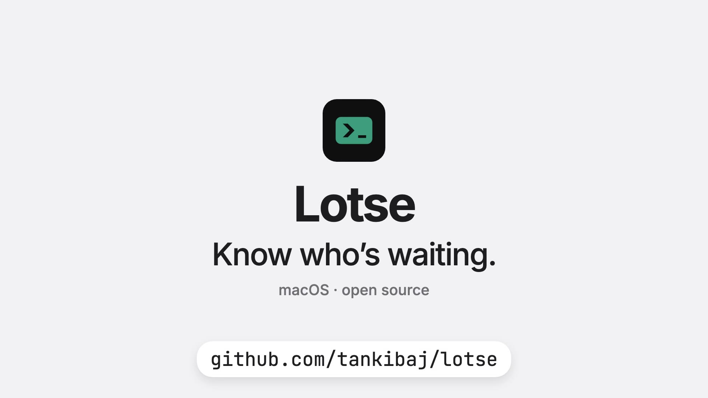

# Lotse

**Which agent needs you?** Waiting. Failed. Done. One sidebar.

<p align="center">
  <a href="docs/media/lotse.mp4"></a>
</p>

Lotse is a macOS terminal for people who run several coding agents (Claude Code, Codex, OpenCode) across several projects. Each agent runs in a real terminal pane. The sidebar shows every session's status, so you never tab-hunt to find the one that is waiting for a permission, has failed, or has finished.

- **Status at a glance:** `run`, `perm`, `fail`, `done`, `idle` per session, rolled up per project, with sub-agents and a "needs you" count in the status bar.
- **Answer without switching:** a permission arrives as a sidebar card and a notification with Allow, Deny or Always allow. `⌘J` jumps to the next session that needs you.
- **Real terminals:** xterm panes with tabs and splits. Quitting the app does not kill sessions (a background daemon owns them).
- **Parallel work in worktrees:** start a session in a new git worktree, split beside it with `⌘D`.
- **Review loop:** open the diff of a session (`⇧⌘R`), comment on lines and send the comments back to the agent.
- **Local only:** no telemetry, no update checks, no network listeners.

Status: **Beta**, Apple Silicon, macOS. Version `0.1.6`.

## First run

1. Start Lotse. It starts the daemon in the background and creates `~/Library/Application Support/Lotse` (folder `0700`; socket, token and database `0600`).
2. **Add a project** (`⇧⌘O`): pick a folder, scan a folder for repositories, clone a URL, or create a new folder.
3. **Start a session:** `⌥⌘T` opens Claude Code, `⌘T` a plain terminal. Codex, OpenCode and shell commands come from New session. Launch commands are detected from your login shell's `PATH` and editable in Settings.
4. Work as usual. Status comes from a per-pane integration (see [How status works](#how-status-works)); nothing in your agent configuration is rewritten.
5. `⌘K` jumps to any session or command, `⌘J` to the next session that needs you, `⌘/` lists all shortcuts.

### Shortcuts

| Keys | Action |
|---|---|
| `⇧⌘O` | Add project |
| `⌘T` / `⌥⌘T` | New terminal / new Claude Code session |
| `⌘1`…`⌘9` | Tab *N* of the project |
| `⌘J` | Next session that needs you |
| `⌘K` | Command palette |
| `⌘D` / `⇧⌘D` | Split right / down |
| `⇧⌘R` | Review the selected session's changes |
| `⇧⌘↩` | Composer (multi-line prompt) |
| `⇧⌘I` `⇧⌘G` `⇧⌘F` `⇧⌘T` `⇧⌘U` | Panels: Session, Changes, Files, Transcript, Usage |
| `⌃⌘S` / `⌃⌘Z` | Toggle sidebar / focus mode |
| `⌥⌘N` | Pause notifications |
| `⌘/` | Shortcut sheet |

## How status works

- **Claude Code:** a per-pane plugin is injected for the session (`--plugin-dir`). Nothing is written to `~/.claude/settings.json`.
- **Codex:** each pane gets a mirrored `CODEX_HOME` under the Lotse data folder. Nothing in `~/.codex` changes (details in `integrations/codex/README.md`).
- **OpenCode:** a per-pane plugin.
- **Shells:** detected from the terminal's own signals.

Older Lotse versions installed global hooks. Settings › Agents offers "Remove old global hooks" for those.

## Install

### Homebrew

```sh
brew install --cask tankibaj/tap/lotse
```

Apple Silicon only. The release is ad-hoc signed and not notarized; the cask removes the quarantine attribute for you.

### Build from source

Needs Rust 1.95 (`rust-toolchain.toml`), Node 22 and the Xcode command line tools (`codesign`).

```sh
git clone https://github.com/tankibaj/lotse.git && cd lotse
(cd app && npm ci)
sh scripts/build-app.sh          # release build, ad-hoc signature, smoke test (~5 min cold)
ditto target/release/bundle/macos/Lotse.app /Applications/Lotse.app
open /Applications/Lotse.app
```

`scripts/build-app.sh` puts the daemon (`lotsed`) and `lotse-hook` next to the app binary, signs the bundle ad hoc, verifies the signature and starts the bundled app against a temporary data folder to see the daemon socket appear. `--no-smoke` skips that step.

The build is signed ad hoc and not notarized. Built on your own Mac it opens normally. A copy that came through a download or AirDrop is quarantined: `xattr -dr com.apple.quarantine /Applications/Lotse.app`, then open it (or right-click › Open).

## Architecture

- `lotsed` (Rust daemon) owns the PTYs and state and listens on a Unix socket (`~/Library/Application Support/Lotse/lotsed.sock`).
- The app (Tauri 2, React 19, Tailwind 4, xterm.js) is a client of the daemon.
- `lotse-hook` is the small CLI the agent integrations call; it forwards status events to the socket.
- `lotse-proto` defines the wire protocol (`PROTO_VERSION = 5`); JSON fixtures in `crates/lotse-proto/fixtures` are the shared contract with the TypeScript `DaemonClient`.
- `lotse-detect` reads agent output (screen, OSC) for status; `lotse-git` provides branch, worktree and diff data.

## Privacy

- **No telemetry**, no update checks, no remote manifests or assets at runtime. The only network traffic is what the programs you run in a session do themselves (and `git clone` when you ask for one). PR status via `gh`/`glab` is opt-in.
- **No network listeners:** one Unix socket (`0600`, in a `0700` folder, peer uid checked). Every connection must send the token from `~/Library/Application Support/Lotse/token` first. There is no TCP or UDP socket in the daemon or the app (the Vite dev server on `127.0.0.1:1420` exists only in `npm run dev`).
- The webview runs with a strict CSP (no remote origins, no `unsafe-eval`) and a minimal capability set.
- Integrations talk to the local socket only. They send the event, tool name, ids and the tool's command or path (the card summary), and leave out prompts, replies, file contents and tool output.
- Auto-allow rules are off by default. Transcript export masks secret-looking values.

## Uninstall

Quit the app first (`⌘Q`): it restarts a daemon that died. Then:

```sh
D="$HOME/Library/Application Support/Lotse"
kill "$(cat "$D/lotsed.pid")" 2>/dev/null            # stop the daemon (ends its sessions)
rm -rf /Applications/Lotse.app                       # the app
rm -rf "$D"                                          # database, token, socket, log
rm -rf "$HOME/Library/WebKit/dev.tankibaj.lotse" "$HOME/Library/Caches/dev.tankibaj.lotse" \
       "$HOME/Library/Saved Application State/dev.tankibaj.lotse.savedState"   # webview data, if present
```

If you used an older version that installed global hooks, run Settings › Agents › "Remove old global hooks" first, or `lotse-hook integration claude uninstall` and `lotse-hook integration opencode uninstall` (the binary is `Lotse.app/Contents/MacOS/lotse-hook`).

Worktrees Lotse created live in `~/.lotse/worktrees/<project>/<branch>`. Each is a normal git worktree and may hold unmerged work, so they are not removed above. Per repository: `git worktree list`, then `git worktree remove <path>`. Once none is left: `rm -rf ~/.lotse`.

## Develop

Requires Rust 1.95 (`rust-toolchain.toml`) and Node 22.

```sh
cargo fmt --all --check && cargo clippy --workspace --all-targets -- -D warnings && cargo test --workspace
cd app && npm ci
cd app && npm run dev          # UI with a mock client: http://127.0.0.1:1420
cd app && npm run tauri dev    # Tauri window with the real daemon
cd app && npm run lint && npm run typecheck && npx vitest run && npm run build
node scripts/licenses.mjs      # licence summary of what ships (see THIRD_PARTY_NOTICES.md)
```

Agents working on the repo: read `CLAUDE.md`.
